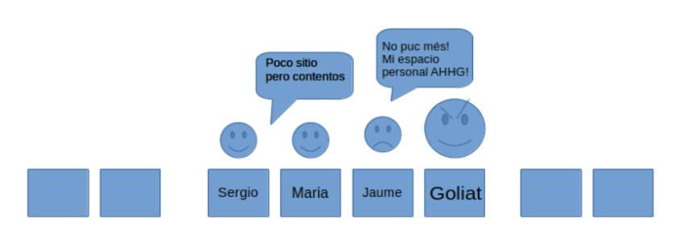
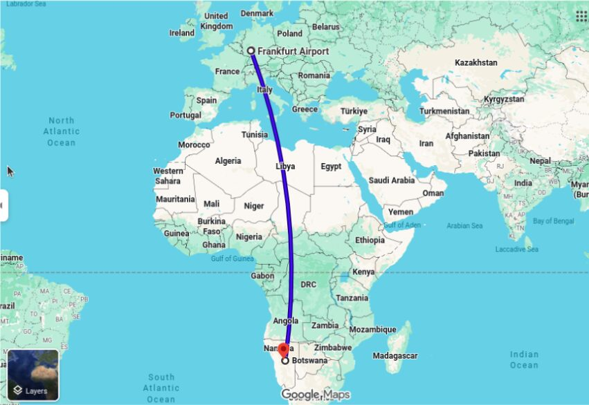

Our adventure began on 20 March 2026. After months of preparation, the day had finally come. The afternoon before, we were in the AUCOOP office packing our suitcases. Anyone who saw us would not have thought we were going to Namibia, but rather moving house with a load of equipment. Across three suitcases, wrapped in bubble wrap, we packed 12 laptops, 11 routers, 4 Proxmox servers, 2 switches, cables, chargers… We also brought a crimping tool, among other tools for laying cable, and network monitoring devices. Are we really going to Namibia?

After an express working day, we found ourselves at the check-in desk at El Prat. Sergio, always thinking ahead, had bought some 3-in-1 oil and cleaning alcohol for electronic devices at the last minute. We squeezed them into the last gaps in the suitcases and walked up to the desk.

The lady at the desk asked whether we had electronic devices in our suitcases: it is recommended to carry them in the cabin, because the hold is not pressurised and lithium batteries can cause problems. María, a bit distracted, answered yes… and as the words left her mouth she realised her mistake. How were we going to carry all that equipment as hand luggage? It had to stay in the checked bags.
To fix things, she said that her laptop was in the suitcase and that she would take it out now, stepped back a little, and put on a bit of a show. Meanwhile, Jaume and Sergio were handed the list of prohibited items: firearms, poison, explosives… and alcohol stronger than 70%. Sergio began to think that what had seemed like a good idea might give us a hard time at customs.

We trusted our luck and hoped the equipment would arrive safe and sound with us. We put everything on the conveyor belt and, slightly worried, headed to security. Next stop: Frankfurt.

While we waited, we shared our impressions and pooled what each of us had read about the history of Namibia: the different countries that held colonial power over the territory until its full independence in 1990, the wildlife, the different regions, and what to expect from the region we were heading to. It is part of the Kalahari Desert, with red sand and savannah landscapes. The more we talked, the more the adventure ahead started to feel real.

We arrived in Frankfurt hungry and a bit late, so although we would have liked to take it easy, we hurried off the plane in search of our next gate. Sergio was still worried about the alcohol… What if they stopped our bags here? But we were so short on time that we simply kept going.

We made it to boarding without trouble and looked for our seats: row 40, seats together. Jaume had been bragging ever since we got our boarding passes that he had the aisle seat, lucky him… But his calculations were off. This plane had a 2-4-2 layout, not the expected 2-3-2, and he ended up in seat 3, next to a giant of a man who shamelessly fought him for the armrest and the legroom from minute one… To make the trip a bit more bearable, Sergio and Jaume decided to pay for the in-flight internet and spend a while on personal projects. María was happy to start a book that Sergio had downloaded and shared to her Kindle.

None of us managed to sleep much, but little by little we got closer to our destination.

