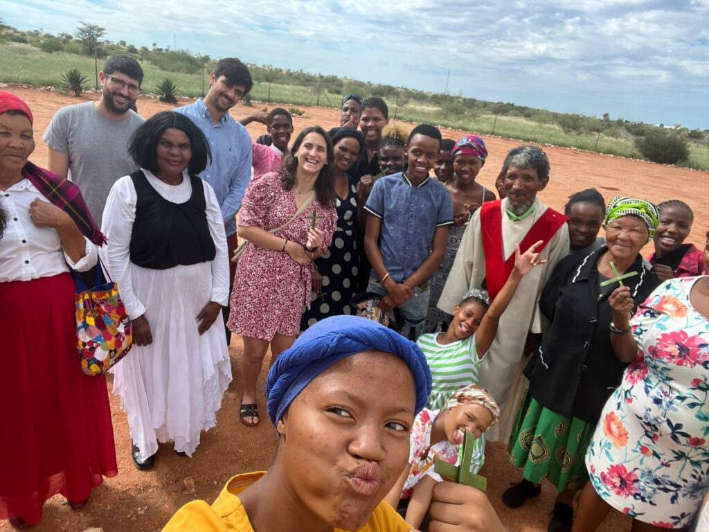

Third day without coverage. Our families and loved ones must think we have died or been abducted by UFOs. What actually happened is that the rain damaged some point of the communications line, and the Gochas network has a "single point of failure" topology… They still have not been able to fix it, so there is nothing to do. Even so, we had a VERY exciting plan for the day ahead.

It was Palm Sunday and María wanted to go to Mass in the village. On Wednesday we had stopped by the church and met a very old man, with the typical features of the area, raking the courtyard: Albert. He told us that on Sunday there would be a service but not Mass, because the priest could not come.

The guys got up at 7:15 to run their daily kilometres; yesterday was a recovery day, and today they went to discover new horizons.

When they got back, we had a quick breakfast together and got dressed for church.

When we arrived, Albert and Melisa welcomed us and told us they were waiting for some choir members to begin. Albert spoke to us in Afrikaans and Melisa translated into English. The celebration began outside with singing and the blessing of the palms. It was very impressive to see how they sing and how the liturgy adapts to the culture to express the spirituality of the people (or so María says).

Then we went inside the church. The singing continued, then the Gospel reading and the sign of peace, when we greeted all the parishioners around us, all of them from the village, all Black. And so the celebration went on until communion. At the end they sang a few more songs accompanied by a small drum that filled the whole church with uplifting melodies. Jaume and Sergio, who had wanted to go with María, came out happy to have shared the experience together.

On the way out they told us the plan for the week: Good Friday, Easter Sunday… And to record that new faces do not show up every day, they asked us for a photo with the group.

We left happy, and on the way home we still could not believe the main event of the day was still to come. Mass had already been quite an experience, but today was the day we were going to Zackie's (Mr. Muller's) farm. We grabbed a few beers, climbed into Zackie's pick-up and drove 20 km south.

We arrived at the gate of the property: 8,000 hectares, and WHAT hectares. Before going in, we picked up a worker to give Mr. Muller a hand: Moisès, a Nama man who lives outside the farm with his family and works with the sheep.

We drove up a winding track to a raised flat area with 4 buildings, 3 sheds and a house, all surrounded by green lawn. We drove into one of the buildings, where there were several 4×4s kitted out for hunting, a John Deere tractor… Moisès and Mr. Muller got a Toyota pick-up ready, with open-air seats in the back, and we piled in with Mr. Muller at the wheel.

And off we went into the open country.

*[Video in the original post](https://aucoop.upc.edu/2026/03/31/dia-10-safari-inesperat/)*

The landscape is savannah. We drove between red sand dunes, and as we went we were surprised by springboks leaping between bushes, oryx, red hartebeest, and many other animals we did not even know existed. The dunes cut across the land and create valleys where the animals graze peacefully. There are no predators on the property, so they have nothing to worry about. Mr. Muller told us that at certain times of year leopards come through, but they prefer to go after the sheep, which are easier prey than the wild animals.

At one point we turned and, a kilometre further on, saw 3 giraffes in the distance. GIRAFFES. They got nervous when they saw the car and ran off. We slowed down and approached little by little. WOW, they are so impressive.

*[Video in the original post](https://aucoop.upc.edu/2026/03/31/dia-10-safari-inesperat/)*

We stopped right there: our own private safari. We opened some beers and took in the scene. The landscape stretched to the horizon, and we could not believe how lucky we were to enjoy it.

Back at the inhabited part of the farm, he showed us another of the hangars. He explained that one of his partners comes to hunt and likes trophies. We went in and what we saw left us open-mouthed: a small plane, quad bikes, and at the back a stuffed cheetah, an oryx, a gazelle… It is a world very different from ours, but at the same time hugely spectacular.

*[Video in the original post](https://aucoop.upc.edu/2026/03/31/dia-10-safari-inesperat/)*

We took one more drive around the property and went home, where a barbecue with Petru and Zackie was waiting for us. They had prepared cuts of lamb, sandwiches, potato salad… A proper feast. We got the fire going and spent the afternoon there, in good company and with good food. It was a great chance to get to know them a bit better; their hospitality today knew no limits. They had looked after us all week, and ending with this barbecue was the icing on the cake.

We finished very full and, once everything was cleared up, took a short nap.

Back in the land of the living, Sergio started to worry: he had to work tomorrow and the coverage had still not come back. We lazed around for a while and then went for a drive; we could not get any work done or continue with the documentation. Oh well, maybe we will have more luck tomorrow.

We played "cul" (a card game also known as President) for more than 2 hours and, after many rounds with Sergio stuck at the bottom of the table, he finally managed to finish as president.

With that good taste in our mouths, we talked about the day and, after a long chat, went to bed.

*[Videos in the original post](https://aucoop.upc.edu/2026/03/31/dia-10-safari-inesperat/)*
