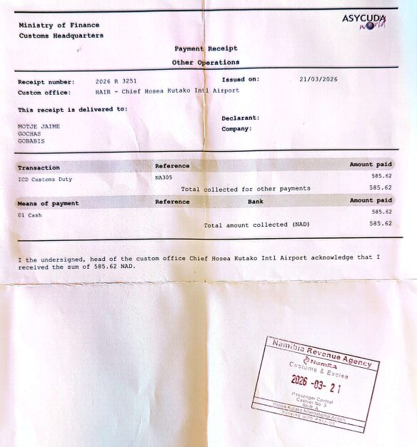
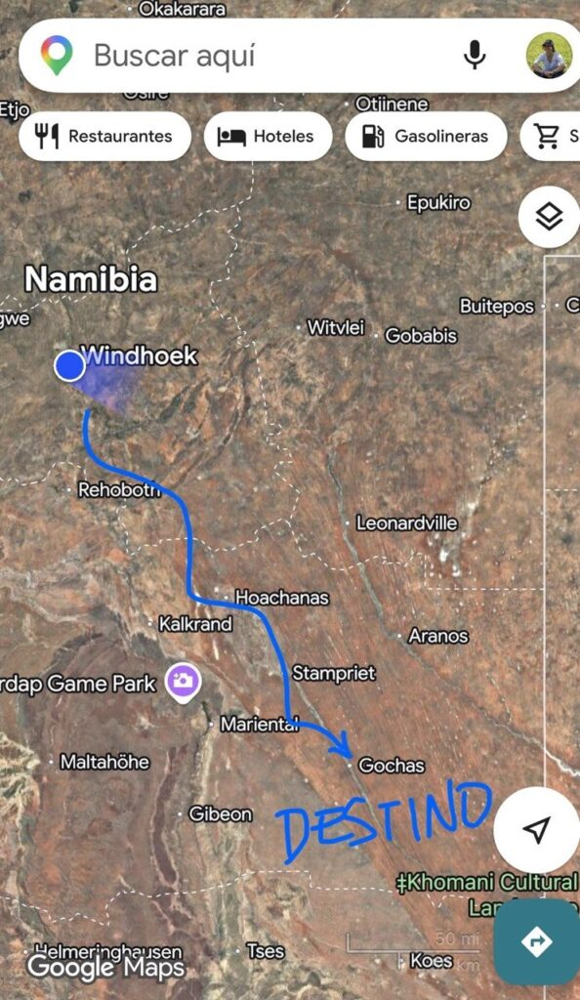
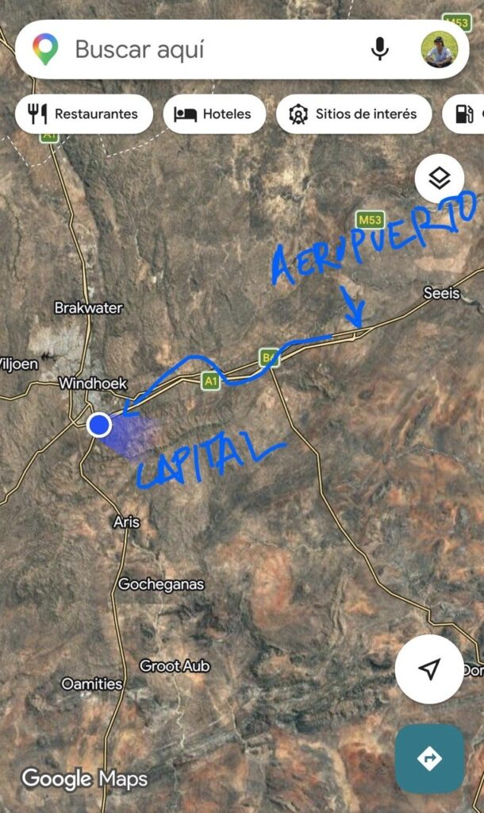

We woke up in the morning after sleeping badly for a few hours on the plane and landed at the airport. We spent an hour and a half queuing at immigration. We got through without any problems, and then came the trickiest part of this kind of trip: customs.

In principle there is a legal process to declare a donation and bring electronic equipment into the country without paying anything, but in our experience with projects like this one, the process is complicated, very slow, and not always successful. So the best option is usually to try to "slip" the equipment through customs. Having been through this before, we went through customs separately. Sergio went first, then Jaume and María. Sergio and Jaume were sent to the customs office, and María got through without a problem.

In the office, Jaume and Sergio spent a long time negotiating with the customs officer, pretending a bit not to understand what he was saying. We showed him the letter that Theo Pauline, the director of the children's shelter in Gochas, had prepared for us. Her phone number was on it, and the officer called her. Theo Pauline tried to convince him that it was a donation for the young people of the village. The officer hung up and told us to agree on a price for 6 refurbished computers, 10 routers and 2 switches. We ended up settling on the equivalent of €150. Sergio went to change the money, and when he came back the officer told us to pay only 20%, around €30. So we went to the counter, paid, and with that we finally got through customs, satisfactorily and legally :).

From there we picked up the car we had rented (and realised that they drive on the left, a legacy of British colonial rule), drove to the capital, Windhoek, to buy a projector the school needs, ate at a fast-food place in the shopping centre, and set off on the long drive from Windhoek to Gochas.

The landscape was arid the whole way, but its shades kept changing: from white sand to reddish sand, from mountains to savannah. The most spectacular part came well after dusk. From Mariental to Gochas there are 80 km of unpaved road, and there we saw an incredible variety of wildlife: oryx, springboks, owls, yellow mongooses (a close cousin of the meerkat)… But what surprised us most was a flock of ostriches that got startled when they saw us coming.

*[Two videos in the original post](https://aucoop.upc.edu/2026/03/24/dia-2-llegada-a-windhoek-y-viaje-hasta-gochas/)*

We finally reached the hotel just after 8. You enter the hotel through the bar, and there we found an interesting scene. First, the owner of the bar (and the hotel) told us what the village is like from his perspective, which, let's say, was curious. Mr Müler, from a German family that arrived in Namibia in 1890, was born and raised in Gochas and bought the hotel in 2020. Then we chatted for a while with a group of Lithuanians and their guide, Pastik, who had come to hunt for the weekend. Mr Müler told us they had shot 112 springboks.
