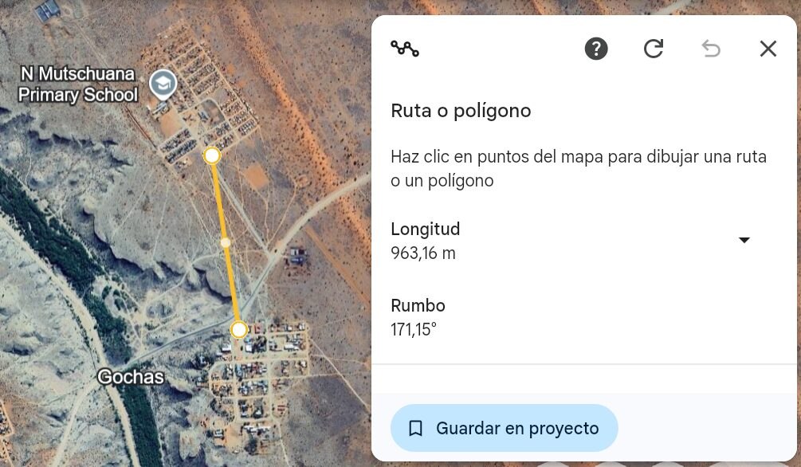
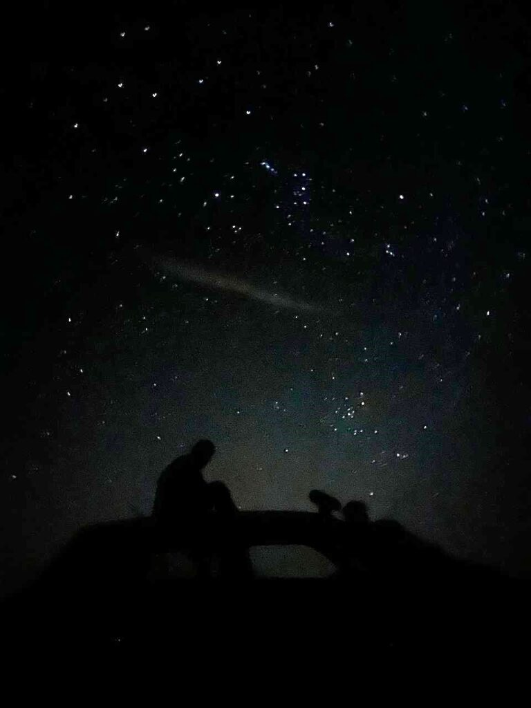

Today we woke up quite early, since yesterday we went to bed very early, worn out from the trip.

In the dining room we met Petru, the hotel manager: a very friendly woman in her late sixties who greeted us with an ear-to-ear smile. She brightened up our morning.

At eleven we headed to the north of the village, about a 20-minute walk from the south. People call this area "the location". We were grateful to have a car, because walking there every day would be quite hard given the distance and the heat.

Once there, we were surprised to see that, despite being in the same village, the buildings changed radically. We went from nice houses, some even with gardens, to much humbler homes, many of them made of corrugated iron.

As a curious fact: according to Pablo, an architect from [Fowndawtion](https://foundawtion.org/en/home-english), the distance between the two parts of the village is far from random. You may be wondering how far apart they are. You can work out the answer from the following:
mosquitoes are the deadliest animal for humans, and most mosquitoes in the area do not travel more than 500 metres.
Exactly: the two parts of the village are more than 500 metres apart.

At the school, Gerda, Mr. Isaak and the rest of the team welcomed us with open arms. What lovely people! After a short introductory meeting, they showed us the facilities and the setup they have. This is where we started discussing the different options for building the network, and brainstormed where to place the Wi-Fi access points and how to configure them.

We went back to the hotel, but not before taking a stroll around the village. The walk takes five minutes and confirms what we already suspected: there is not much to do around here, hehe.

We had instant noodles (good thing we bought them, because on Sundays the hotel staff, Petru and Polina, take the day off) and began sharing a bit of our culture with Namibia: we watched football and took a nap.

When we woke up, we were surprised (though not very) to find that the power had gone out in the whole village.
We decided to go for a beer at a hotel 6 km away. María and Jaume were once again grateful for the car, but Sergio, who is aiming for a sub-2-hour marathon, decided to run there.

*[Video in the original post](https://aucoop.upc.edu/2026/03/24/dia-3-coneixent-la-comunitat-de-gochas/)*

We also took the chance to look at the stars. Even though the moon caused quite a bit of light pollution, we ended up mesmerised: they are much more visible here, and different too. Being in the southern hemisphere, we could see constellations that are not visible from the north, such as the Southern Cross, which appears on the flags of Australia and New Zealand.

