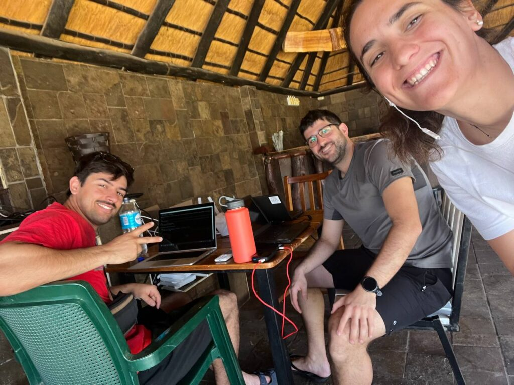
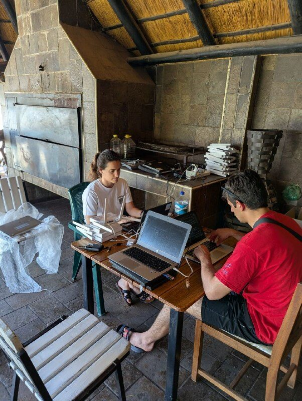
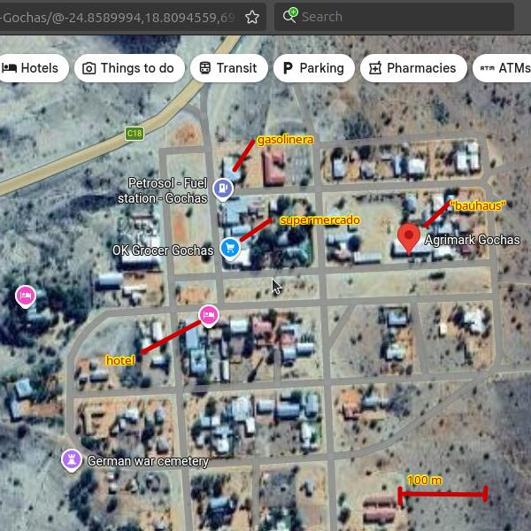
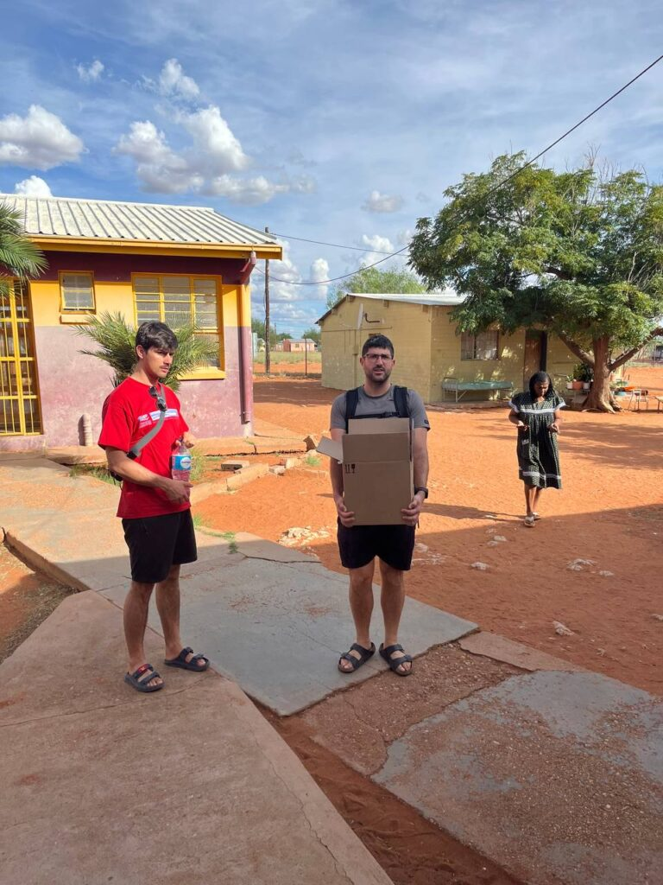
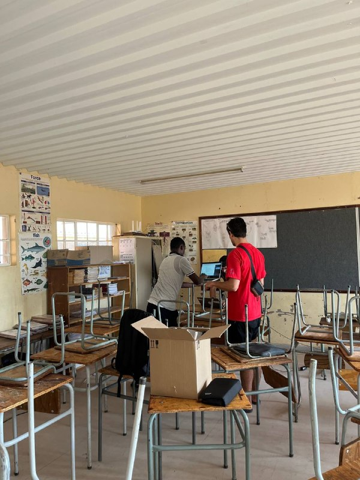
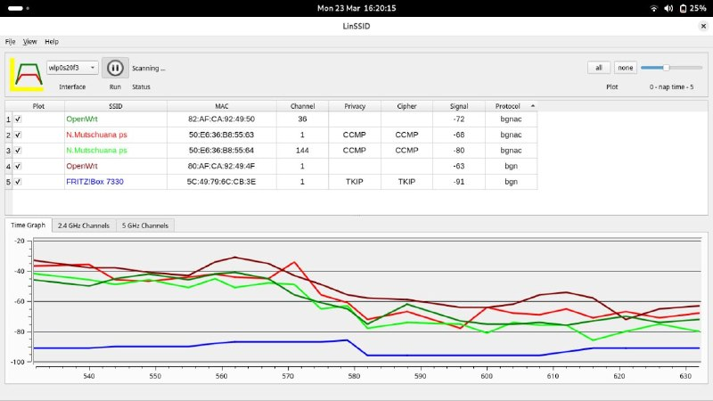
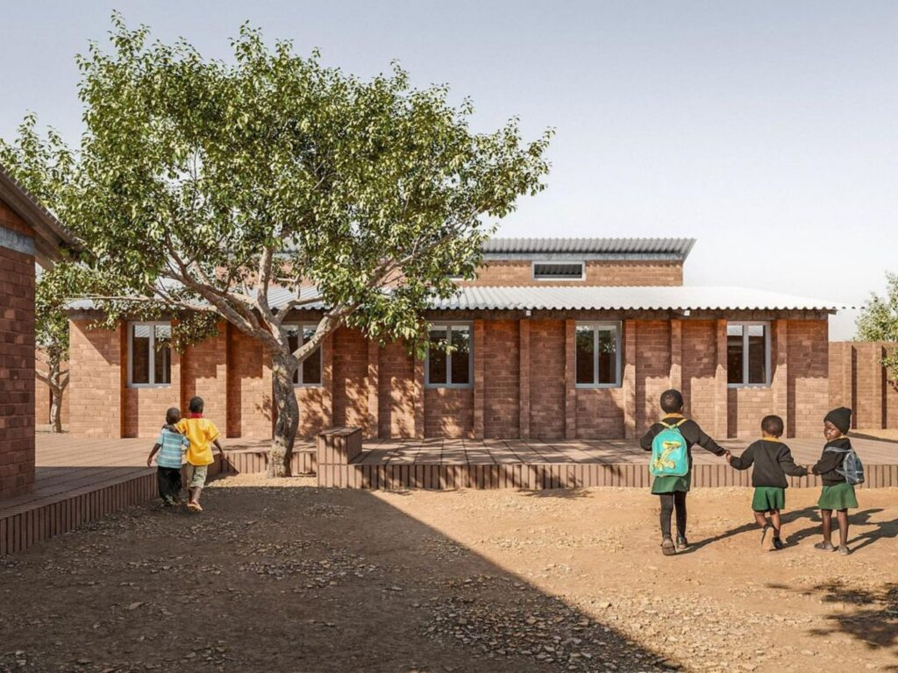
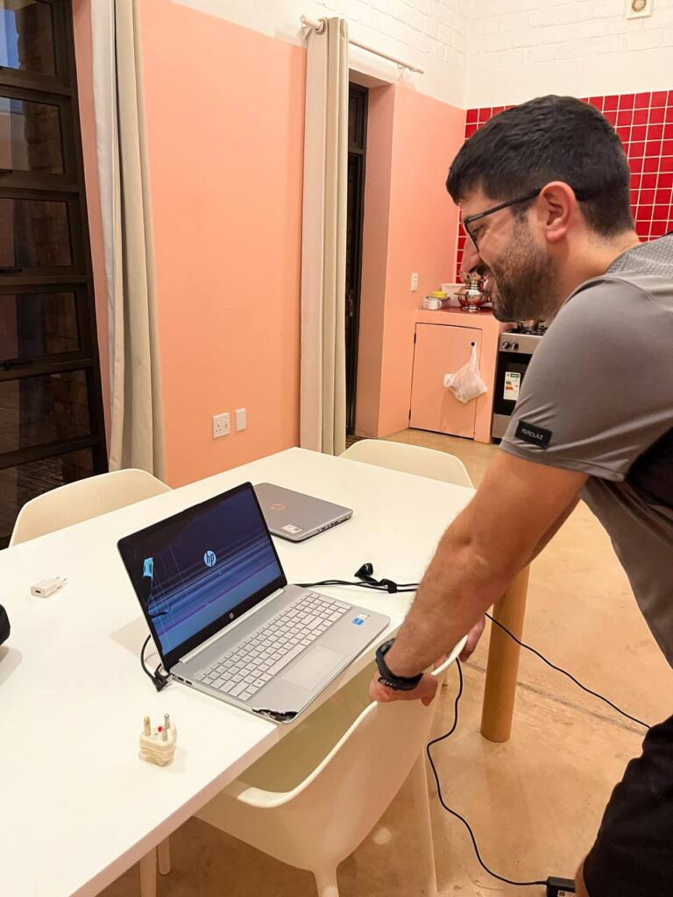

Today, Monday 23 March, the full-time technical work began. In the morning we set up on the porch in the hotel garden and laid out the routers and laptops.

Yesterday we drew up the plan of attack for the week. Today's tasks: configure all the routers with the open-source firmware OpenWrt, go to the village's two shops at midday to buy some food and supplies, and finish the day with fieldwork at the school.

With that plan in mind, we had a leisurely breakfast, which made us start later than planned, but by 9:30 our setup was ready.

We worked in parallel: Sergio catalogued the computers, Jaume took care of the guide, and María started flashing the routers. We put on some background music and the morning flew by, with pretty good results. We met our goals.

At midday we went to explore the shops. First stop: Agrimark. We expected a building and farm supplies store. There are many "farms" around here: large stretches of land with livestock, crops and even hunting grounds. So even though the village has fewer than two thousand inhabitants (central part plus the Location), it makes sense that the Agrimark looks like a small DIY superstore. We found plug adapters (we brought more than 30 devices, all with European plugs… and only thought to check whether Namibia uses the same plug on the last day…), painter's tape and a few other things. We were very pleasantly surprised by how much they stock.

From there, the next stop was the supermarket; everything is literally a stone's throw away. We wanted to buy some fruit and vegetables: the hotel menu is not very "healthy" if you eat it every day, and since Petru had put a fridge in our room, we wanted to make the most of it and add some variety. Also, the kitchen closes around 7 pm, so having our own food gives us more freedom if we keep working into the evening.

Jaume bought some cured meat that tastes a bit like death, but he is happy to have tried something typical of the region. We also bought a few beers to keep in reserve. We are ready to take on the week!

Back at the hotel we quickly ate some empanadas from the supermarket; the top-rated one was chicken and mayonnaise.

With our energy restored, we went to the school to start the fieldwork. Gerda welcomed us and introduced us to one of the maths and science teachers, who showed us their setup: 2 fairly old ADSL routers with a connection of doubtful stability.
We spent the next two hours running tests and checking the connectivity in the different classrooms.

After finishing the survey, we stopped by the staff room to collect some computers that run slowly, to take a look and see whether we can improve their performance. By then it was 7 pm, and we still had one more stop.

During the day, TheoPauline had called us. She is the director of the children's home, the "Hostel", for primary school children. She could not see us during the day, but said we could come by in the evening to meet her in person.

The meeting was very moving. We arrived at the house built by [Foundawtion](https://foundawtion.org/en/archivos/6043), and it is a MARVEL, both architecturally and in the work it does for the Gochas community. The house takes in 60 children from the "Location" whose parents are unable to look after them, as well as orphans.
They had just finished dinner and were about to go to bed.

TheoPauline told us about the reality of the primary school in Gochas, which has more than 300 pupils. School dropout rates are far too high for primary school children. When they looked into how to reverse this, they saw that behind it there were usually parents who neglected their children… And as hard as it is to say, the parents were simply unable to take care of them or to understand the importance of their children's education.

The house has room for 60 children. With this small action of great impact, the project she leads aims to change the current reality and the future of these children, and over time, of the whole community.

When we finished talking, we asked her about the computers they have and whether there is internet at the house. For now the government has not installed an ADSL router, so there is no connection. As for the computers, TheoPauline said one was broken and there was another she did not understand. Sergio said, with a mischievous tone, "I bet the one you don't understand is from Labdoo." TheoPauline went to look for them and, sure enough, Sergio was right.

We said goodbye warmly and promised to come back again during the week.

Back at the hotel we went for a run. Sergio set the pace, 36 minutes at 6.5 km/h. María held on until minute 15, since the cold she has would not let her do more, and Sergio and Jaume pushed hard to the end.

We made a small salad for dinner and had some well-deserved beers. A good day's work!
More and better tomorrow.
