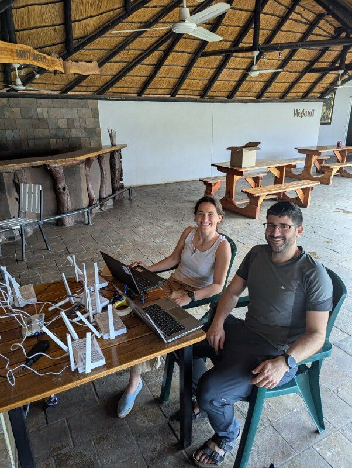
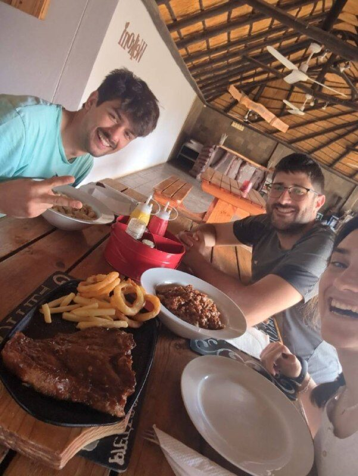

Today we got up a little earlier to make the most of the day, our second working day. At 7:00 we made breakfast with what we bought yesterday: a feast of fruit with oats and cereal.
This morning we tackled one of the tasks we had been putting off for days: the travel blog. The three of us started writing up the previous days, and we resolved to write a bit every morning so it does not pile up; otherwise we would reach a point of no return, which we want to avoid.

Sergio wrestled quite a bit with WordPress, and María had fun drawing a comic strip to illustrate Jaume's misfortune on the plane, which she shared with all her family and friends. We spent a good while getting the posts ready, and suddenly Jaume said, "It won't let me in…". Sergio looked into it and saw that, because we were accessing from Namibian IP addresses, we had been blocked on suspicion of being hackers or something similar.

Sergio and María configured the mesh while Jaume finished setting up the network monitoring devices.
Before we could finish configuring everything it was 1:30, and since we were starting to understand how the kitchen works, we asked Petru to order lunch. We decided to have one hot meal a day and sort out the rest ourselves.
We looked at the menu and our mouths watered at the prospect of pasta and a good piece of meat. We ordered and kept working until the food was ready, around 2. What a feast!

In the afternoon we managed to finish the mesh configuration. Our method for validating the documentation we write is to have the final configuration done by one of the three of us who did not take part in writing it. That way we check that everything is clear and nothing has been taken for granted. This time it was Jaume, who suggested a couple of corrections but otherwise gave the OK! We can push it to production. In case you want to take a look:
<https://aucoop.github.io/Community-Network-Handbook/>

The rainy season in the region is coming to an end. The forecast had been showing rain for a couple of days, and in the afternoon we had a pretty heavy downpour. People look forward to it a lot, because the dry season is very long.

Between one thing and another it was 7:30 pm… Our capacity had dropped a lot, but even so Jaume wanted to finish "one thing". Sergio said he was going for a run right now: we had been working for almost 11 hours and that was too much. Enough for today.

Jaume and Sergio went running; María decided to stay and do some gentler exercise.

Since nightfall there had been lightning on the horizon: a storm was passing through the area. As it was still early, we took the car and a few beers and drove out of the village to watch the storm and talk about the day.

To end the day, we decided that our signature dish would be a good salad and some fruit.

*[Three videos in the original post](https://aucoop.upc.edu/2026/03/25/dia-5-viento-en-popa/)*
