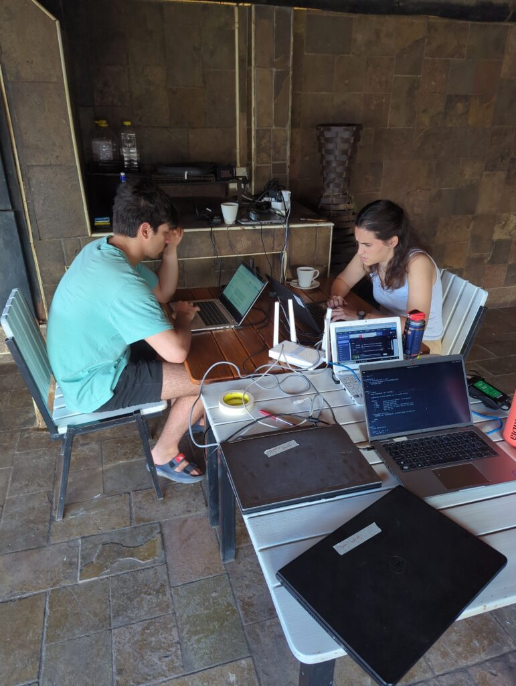
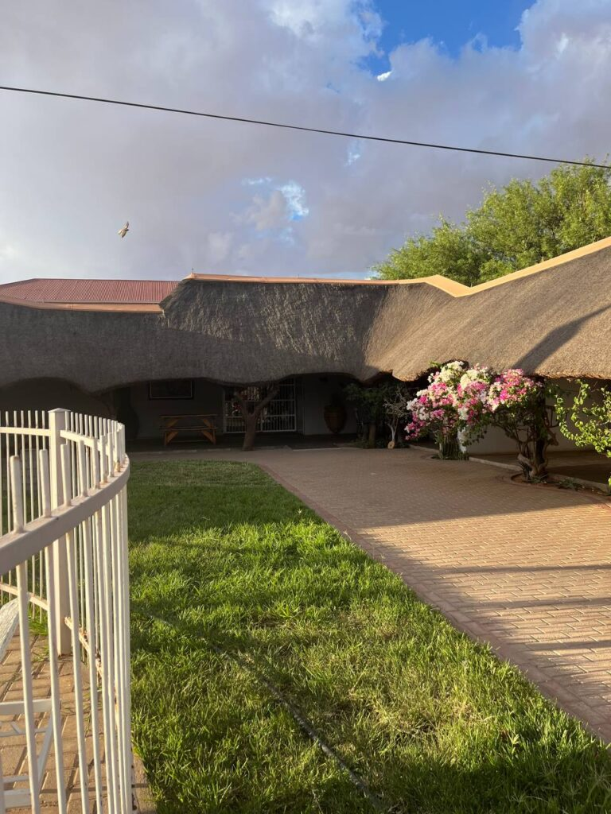
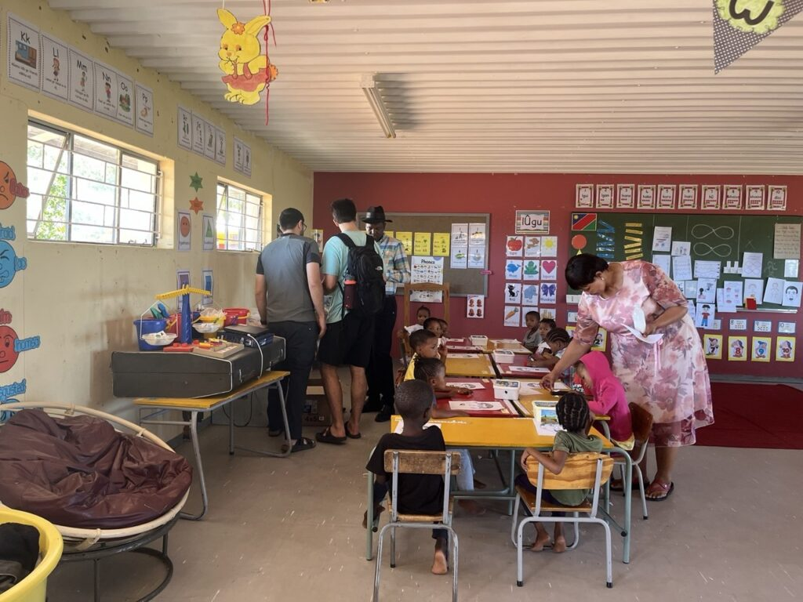
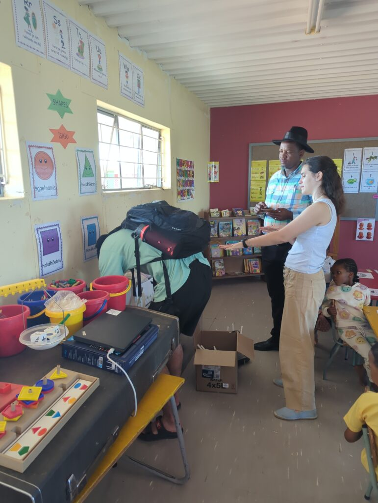
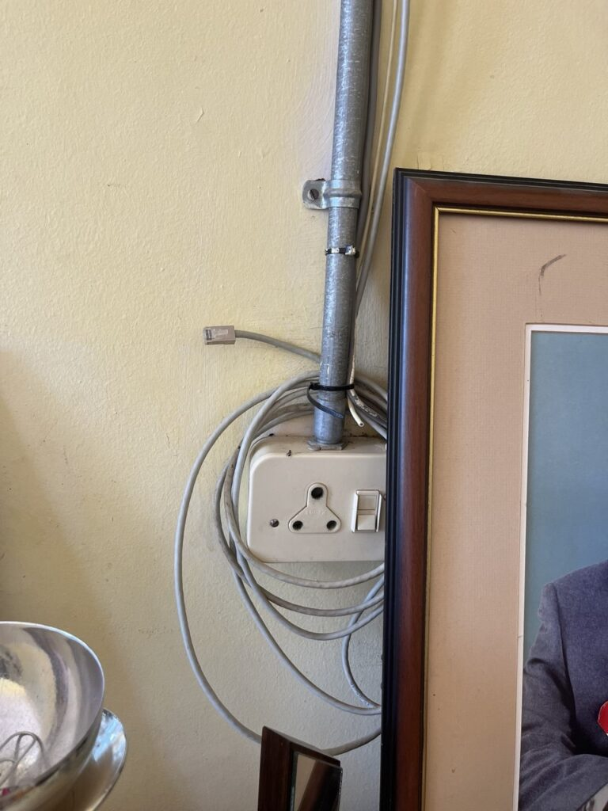
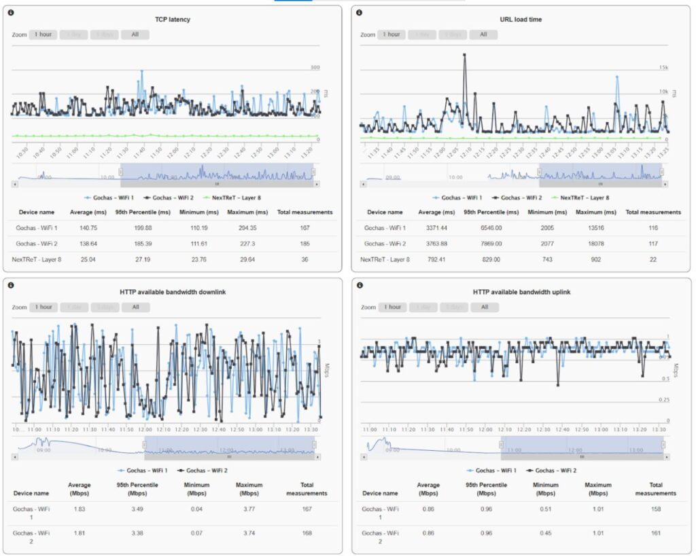
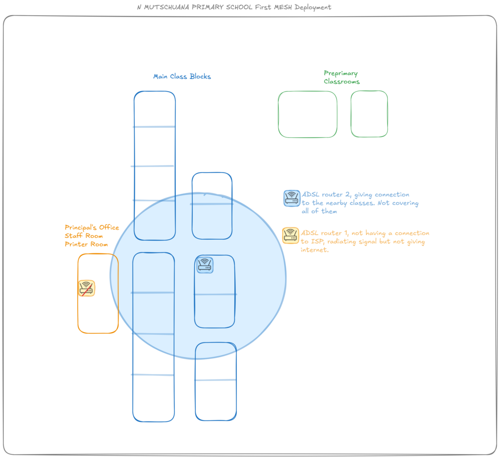
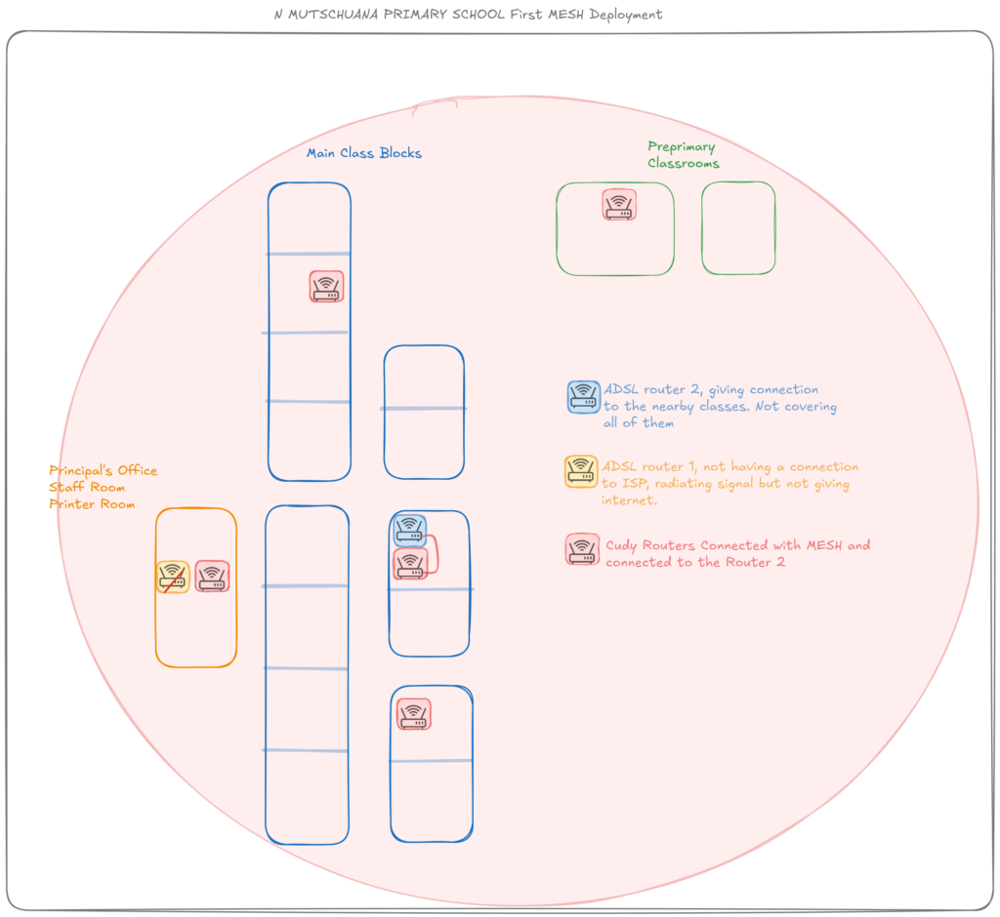
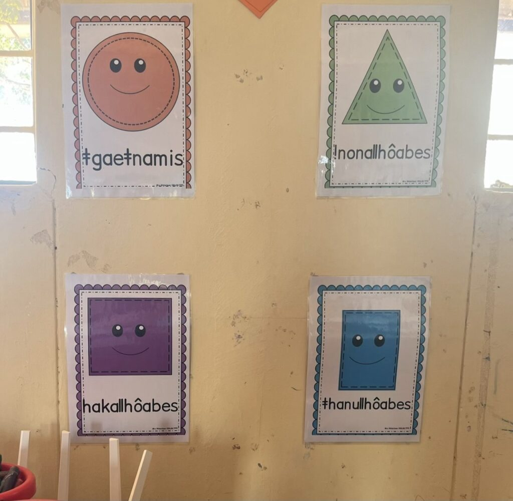
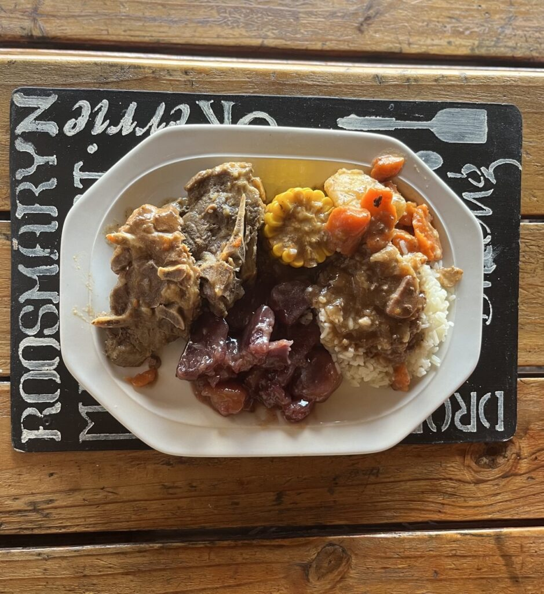

We went to bed with rain yesterday, and today the day dawned cool and sunny. A few clouds could be seen in the distance, but nothing worrying. Even so, the weather forecast said it would rain again today.

After a good breakfast we got to work. We had to go over the router Jaume configured yesterday, because his laptop could not connect to the network. We realised that the WPA3-SAE security protocol was too "modern". After a bit of investigation we managed to fix it.

Just then Gerda (the school principal) called us: the main router in the staff room was not working, and could we come and take a look?

We packed up the computers and routers and in no time we were in the car on our way to the school. It is only a 5-minute drive, but it gave us time to see what the Location is like in the morning: elderly people walking down the street, the kindergarten, which is much humbler than the primary school, and some children and mothers cleaning at home.

We wondered whether those children should not be at school, and got the answer when we arrived: it was around 10 and it was break time. As we greeted Gerda and the other teachers in the staff room, the bell rang and the pupils came in from the playground, some running from home.

Mr X came with us to look at the problem with the main router. Like any IT person, we were under the curse of having "touched" something yesterday that no longer worked. But we had done nothing more than look: the router they said was not working was literally connected to thin air. The cable ended up coiled around a plug connected to nothing, and that is how it was when we checked it on the first day. Not wanting to contradict anyone, we said we would look into it and decided to do the first deployment of the mesh, a network of wirelessly connected routers to cover the whole school.

As Mr X escorted us from class to class, a latecomer came running in, trying to avoid bigger trouble. Mr X stopped him, looked at him very seriously and said "You are late". The boy looked a bit scared, not by the comment but by the small hollow PVC stick Mr X was waving in his hands. Without another word, the boy shot off to his classroom.

We saw that the teachers carry this "tool" as a deterrent. We did not see anyone use it, but the kids know what it can do.

On the other hand, we were pleasantly surprised by how orderly and rigorous the school is. Most teachers dress as if they worked in an office, the children all wear uniforms, simple but clean and smart, the classrooms are tidy and everyone pays attention to the teachers.

That harmony broke whenever we appeared at the door with our box full of routers to see whether the classroom had a socket so we could extend the mesh a bit further. The teacher would welcome us with open arms, and the children gave us a smile and a shy hello.

Within 30 minutes, with a bit of planning, trial and error, and a lot of enthusiasm, we managed to deploy the routers needed to cover the whole school. A small big victory: it will not be the final configuration, but we were able to leave something that works better than we expected.

Mr X, who was initially a bit wary and sceptical because we had "broken" the router, told us, incredulous, "Good job, we should keep in contact".

We left a couple of devices to collect network metrics, simply to understand how it performs over a few days and spot possible fixes.

Before leaving, we stopped by the staff room one last time. All the teachers already had the password for the new Wi-Fi; it had spread like wildfire. They also gave us a few "dinosaur" computers to check.

On the way back we shared impressions. At school, teaching is mainly in English, but Nama is also formally taught; it is the language spoken by most of the local Black population.

English is Namibia's official language, most people speak Afrikaans, and a large share speak the languages of local ethnic groups, Nama in the case of Gochas. These languages have CLICKS in their phonetics. The best-known peoples with these peculiar sounds are the San (also known as Bushmen). The clicks are written with `ǀ`, `ǁ`, `ǃ`, `ǂ`.

Back at the hotel, Petru was waiting for us with the meal of the day. On Wednesdays and Saturdays a hearty dish is prepared for all the staff, and we took the chance to join in and taste something different. Today we were surprised by delicious lamb with rice, corn, carrots and, as the star of the show, purple sweet potatoes that none of us had seen before and that were spectacular.

With a bit of coffee to help digestion, we got back to work. This afternoon called for something less glamorous; after the morning it was hard, but documentation does not write itself. Well, a little bit it does: Jaume has set up some AI agents that can turn a rough draft into good documentation, but the draft still has to be written :/

Sergio went over the teachers' computers, giving them a general clean-up and removing unnecessary programs so we can return them tomorrow.

We analysed the first results from the mesh, and the data confirmed the good feeling we had.

As the afternoon went on, our technological superpowers were called upon again, this time by Petru, who was struggling with the hotel printer. Jaume and María came to the rescue. We treated the computer with affection and patience, and WHAT patience. The computer predates the Pleistocene: opening the file explorer took an outrageous 15 minutes. But in the end we managed.

After that small victory we went back to work for a bit, and a few minutes later the power went out… During the afternoon the sky had been clouding over, and now we could see rain on the horizon.

*[Video in the original post](https://aucoop.upc.edu/2026/03/27/primers-resultats-i-amics-imprevistos/)*

To end the day well, we went for a run. María held on for a good 10-plus minutes, and then Jaume and Sergio set off to explore the outskirts of the village. Since it was still light, they found a new gem: a red sand dune just outside the village, which they christened the "beer dune". We have our next spot.

By the time they got back it was completely dark. María had made friends with two older couples from South Africa on a road trip through Namibia, who had stopped in Gochas to rest for a day. We shared experiences and what had brought us to Gochas, and talked about technology, satellites, Elon Musk…

Jaume and Sergio were at the bar by candlelight, on a romantic date with Mr Muller, beer in hand, swapping childhood stories.

He told us that when he was little his father used to slaughter goats on the farm, and he still remembers the screams, so he does not keep goats on his farm. Those are his "Vietnam flashbacks". He admits he does not like killing animals now, but "business is business".

We all gathered on the porch with the South Africans and made the official introductions: Gordon, Terry, Professor Genny and Linn. What lovely, kind people! They asked us about Spain: Gordon had worked in Barcelona in '92, the Sagrada Família, the 2008 crisis… We talked at length about how their families came to South Africa, the country's history, the war between the Afrikaners and the British, the discovery of diamonds and gold in Johannesburg, Namibia's independence…

With that good conversation and the obligatory salad, we ended the day. The power still had not come back, and the generator for the village's communications antenna had given out at 8 pm. It was 11 pm and everyone here had already gone to bed. We washed the dishes by torchlight and went to sleep with thunder and rain as white noise.
