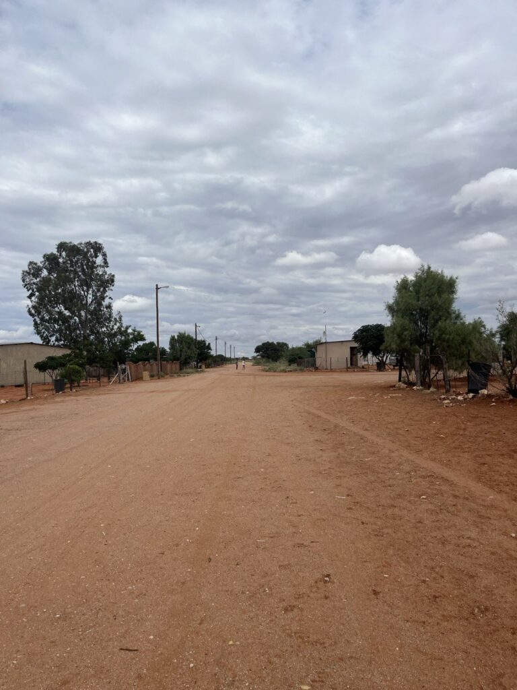
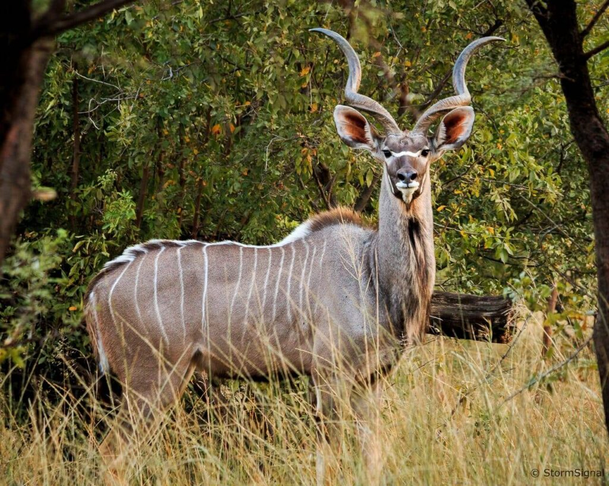
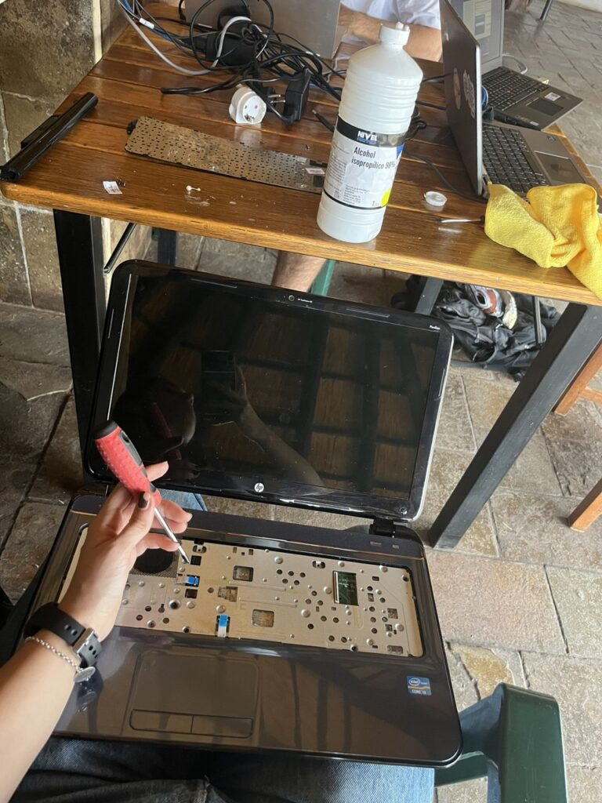

The day dawned cloudy. "Kalahari Desert", they say, but we have seen more water than sun here. You can tell we are at the end of the rainy season: in the early hours we were woken by one of the loudest thunderclaps any of us had ever heard. The storm was right above Gochas.

Sergio was the first one up; by the time Jaume and María opened an eye, he was already dressed and reading on the porch. The power had still not come back, and without electricity there was little we could do. Since Jaume still had battery on his laptop, we used it to work on the blog. So much happened yesterday that it was worth spending a good while writing it up. We had breakfast while watching María write, with the rest of us chipping in ideas for the post (you can tell we took more care because there was no power; if you have not read it yet, [go and have a look 🙂]()). Afterwards we did a final review of the documentation; little by little we are making progress.

Before lunch we went out to explore the part of Gochas we had not seen yet. The village is divided into three areas, a legacy of the *apartheid* system that ruled the country until 1990, when it was still under South African rule. We went to the area inhabited mostly by the Coloured (mixed-race) population and, after walking around, returned to the hotel for lunch. Jaume and Sergio tried **kudu** meat, an animal none of us had ever seen.

After coffee, we went to the school to return the teachers' computers, which we had been cleaning up and tuning. When we got there, it was closed and nobody was around. Asking the teachers who live on site, a woman told us classes had ended because there was still no power.

Before going back to the hotel to keep working, we decided to drive around the farthest part of the *location*. There we found an area of corrugated-iron homes in very precarious conditions. It is striking to see how people live in this part of the village. You can see more about this reality in the wonderful documentary filmed by **Shoot4Change**, the driving force behind this project: <https://www.shoot4change.eu/s4c-next-generation-namibia/>.

In the afternoon we carried on a bit more with the documentation and getting the equipment ready.

As it started to get dark, we went for a run to a spot we discovered the other day and christened **the "beer dune"**.

*[Video in the original post](https://aucoop.upc.edu/2026/03/27/dia-7-kudu-per-dinar-i-una-posta-de-sol-a-la-duna-birrera/)*

Finally we got home, showered, made our usual dinner and went to bed early to face a new day.
