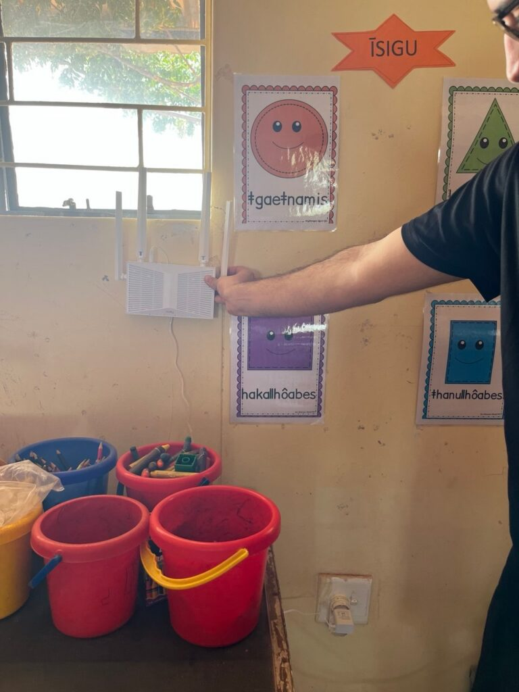

Today was a very full day. We woke up early, aiming to make better use of the daylight. From now on the plan is to get up early so we finish earlier, and that is what we did: a full breakfast and straight to work. We split the tasks to make progress on two different goals.

On one side, María and Sergio worked on the computers. Since these usually come from companies, they normally arrive without an operating system for data-protection reasons, so we have to install a new one. Windows, being paid software, was ruled out. The alternative is Linux. The problem is that people here are quite used to Windows, so we decided to install Linux Mint, a free alternative that also looks quite similar. Next week we will hand over the 13 computers we obtained thanks to donations from Labdoo and NexTReT, and we will run a workshop for more than 20 people to teach the future users how to use them. Although they are similar to Windows, there are some differences we want to explain.

Meanwhile, Jaume carried on configuring the VPN, so that we can provide remote support to the school in the future, once we are back in Barcelona. Like the laptop installs, this task was a complete success.

Around 12 we headed to the school to return the computers the teachers had lent us to check. They complained that they were very slow and wanted to see whether we could speed them up. We did not manage to improve their performance much, since they are very old computers, and you cannot get blood from a stone.

The original idea of the school visit was to quickly hand back the "dinosaur" computers, install a new router and return to the hotel to keep working, but we ran into an unexpected network problem. We could not get the new router to integrate properly with the ones already running. On top of that, the one in the pre-primary classroom was not working as expected. Surprised, we put on our Sherlock Holmes hats and started investigating. After an hour and several wrong hypotheses, we found the problem: we were missing a small piece of configuration that made the routers conflict with each other and fail to route traffic properly. Once identified, the fix took no more than five minutes. This is very typical in our field: finding what is misconfigured takes longer than fixing it. Part of the job, but luckily we are used to it.

We went back to the hotel feeling victorious. We had a quick lunch, a coffee, and got back to work until five, when we shut the computers and started enjoying the weekend.

We got ourselves ready and, just as we were about to go out, we ran into three local farmers who invited us to have a few beers with them. Berti, Carel and Maka entertained us with stories of their lives, very different from ours. They told us they own land around Gochas and spend their time looking after their farms, where they keep sheep and cows as well as many other animals such as oryx, springboks and even giraffes. The latter roam freely over vast areas of land. As we talked, it became clear that our mindsets and ideals are clearly different and hardly compatible; even so, we really enjoyed their company. What was meant to be one beer turned into two, then three, and finally a few shots… Spoiler: we went to bed at almost 1 am, between drinks, stories and different points of view.
