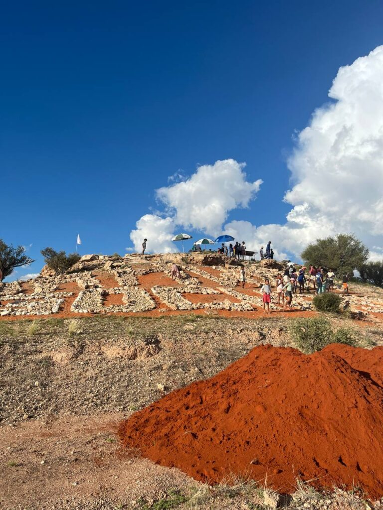
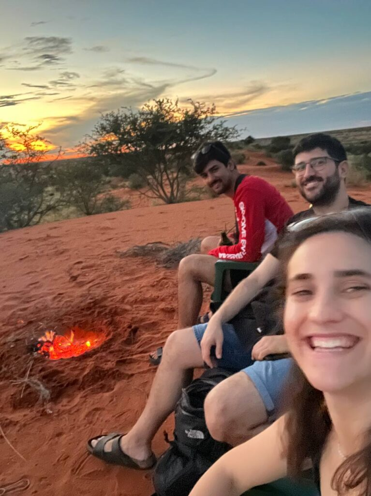

We woke up on Saturday a bit tired from the previous evening with the farmers. We still had no internet connection, but we had a relaxed breakfast anyway and got ready to run a few errands we had pending.

First we went to the supermarket and bought a bit of everything, since we had almost nothing left: water, breakfast food (we usually eat porridge) and things for dinner, which tends to be salad. Then we went to visit Theo Pauline, whom we had not seen for a few days. She told us she had a special activity with the children that afternoon, and we said we would drop by. We also stopped at the Agrimark, a sort of hardware store and supermarket in one. We asked whether the European plug adapters we had ordered had arrived and, while we were at it, picked up some nails and cables to mount the routers high up on the walls.

Back home, we spent a good while playing cards while waiting for the delicious dish of the day Petru was preparing: shredded kudu meat marinated in curry, with some rice. A truly luxurious meal.

After lunch we took a nap and got ready to visit Theo Pauline first and then have dinner on the "beer dune".

We drove to the entrance of the village, where Theo Pauline was with all the children preparing the activity. On one side there was a small fire in a metal barrel, making embers for the meat they would have for dinner. A bit further down, all the children were cleaning the "Welcome to Gochas" sign. We chatted for a while with Theo Pauline and Arnalda, a local woman who helps her with this kind of activity. After watching for a bit, we decided to play with the children and help put red sand on the sign. We stayed for a while and, before it got dark, headed to our dune.

When we arrived we met two local Nama people, a young man and a young woman. She is a teacher at N Mutschuana and recognised us. We chatted with them for a while and then gathered all the firewood we could to make a small fire. Jaume built the fire, we opened a beer and watched the sunset.

We heated up a few tins of beans, and that was dinner. Afterwards we caught a bit of signal (maybe from another antenna, or the village one, we still do not know) and were able to send signs of life to let people know we were still alive.

After a while we went home and to bed early. Ready for a new day.

*[Video in the original post](https://aucoop.upc.edu/2026/03/31/dia-9-cap-de-setmana-tranquil-a-gochas/)*
